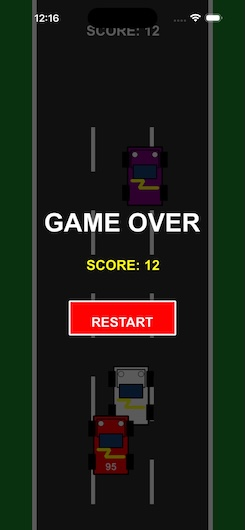

# 日専祭アプリ：（Lightning）
> **AI利用レベル：** 2（生成コード可）
> **最終更新：** 2026-10-17
> **チーム：** カーマニア（26CM0118 スワンテッシェイン、26CM0134 ミン ズォー マウン、26CM0142 ボルドエルデネ）
> 💡 制作の進め方は担任の先生から案内があります。このファイルの項目は、担任の先生の指示で増えることがあります。

---

## 何ができるアプリか（3行）

このアプリは、車を操作するレーシングゲームです。
画面の左側または右側をタップすると、赤い車を左右に移動できます。
現在、車の移動機能を実装しており、今後ゲームの機能を追加する予定です。

## 画面

## 使った文法・技術
UIKit（UIViewController）
 SpriteKit（SKScene、SKView、SKSpriteNode）
 didMove(to:) によるシーンの初期化
 touchesBegan(_:with:) によるタッチ操作
 if 文による条件分岐
 if let による Optional の安全な取り出し
 CGPoint と CGSize による位置とサイズの設定
 position の変更による車の左右移動

## 生成AIの使い方（どの場面で、どう使ったか）

ゲームの企画や機能の整理、3人での役割分担についてChatGPTに相談しました。
また、SwiftとSpriteKitを使ったゲームの作り方や、車を左右に移動させる処理について質問し、コードの書き方や処理の意味を確認しながら開発を進めています。

## 展示で工夫した点
画面の左側と右側をタップするだけで車を操作できるようにし、初めて遊ぶ人でも簡単に操作できることを目指しました。
